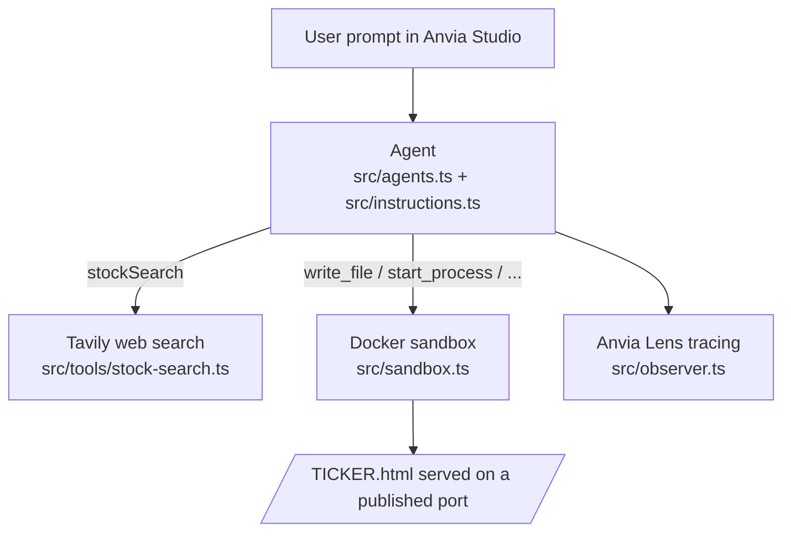

# IDX Stock Researcher

An AI agent that researches a single company listed on the Indonesia Stock Exchange (IDX) and publishes a short, bilingual (Indonesian/English) HTML report with cited sources.

You give it a ticker or company name (e.g. `BBCA` or "Bank Central Asia"), it searches the web for the company's key financials, writes an HTML page inside a Docker sandbox, serves it, and replies with a clickable `http://localhost:<port>/<TICKER>.html` link.

## How it works



1. **Agent** (`src/agents.ts`) – an `@anvia/core` `Agent` configured with the instructions in `src/instructions.ts`, an OpenAI-compatible model (`src/models.ts`), the `stockSearch` tool and a set of sandbox tools. Runs are traced to Anvia Lens (`src/observer.ts`).
2. **Instructions** (`src/instructions.ts`) – the agent's rules. In short:
   - Research exactly **one** Indonesian-listed company per request. If the request has no company, several companies, or an ambiguous name, it asks the user to clarify instead of guessing.
   - Always call `stockSearch` before writing a report and only use facts supported by the returned evidence. Missing figures are written as *"Not found in the available sources."*
   - The report must include: cash & cash equivalents, revenue, profit, total debt (with reporting dates), industry/profile, five years of dividend history, a debt-level label (Very Low / Moderate / High), source URLs for every figure, and an Indonesian/English language toggle plus one small interactive element.
   - Never gives buy/sell/hold recommendations.
3. **`stockSearch` tool** (`src/tools/stock-search.ts`) – takes `{ stockCode }`, normalizes it to uppercase, runs three Tavily searches (financial figures, company profile, dividend history), de-duplicates results by URL and returns them as JSON (`stockCode`, `answers`, `sources[]`, `guidance`).
4. **Sandbox** (`src/sandbox.ts`) – creates an ephemeral `node:22-alpine` Docker container with port `8000` published to the host and exposes file/process tools (`read_file`, `write_file`, `list_files`, `exec_command`, `start_process`, `wait_for_port`, …). The agent writes the HTML report here and starts a web server to serve it.
5. **Entry point** (`src/index.ts`) – wraps the agent in an `@anvia/studio` server on port `3000`, with a sandbox inspector (files, ports, processes). Destroys the sandbox on shutdown.

## Prerequisites

- Node.js (the project uses ES modules and top-level `await`)
- [pnpm](https://pnpm.io/) 11 (declared in `package.json`; pnpm will download it if missing)
- Docker running locally (used for the agent's sandbox)
- API keys:
  - an OpenAI-compatible API key (`OPENAI_API_KEY`)
  - a [Tavily](https://tavily.com/) API key (`TAVILY_API_KEY`)
- Anvia Lens credentials for tracing (a self-hosted `docker-compose.yml` is provided in `lens/`)

## Setup

```sh
pnpm install
cp .env.example .env
```

Fill in `.env`:

| Variable | Required | Description |
|---|---|---|
| `OPENAI_API_KEY` | yes | API key for the completion model. The app refuses to start if it is missing or still `your-api-key`. |
| `OPENAI_BASE_URL` | no | Custom OpenAI-compatible endpoint. |
| `AI_MODEL` | no | Model id passed to the client (defaults to `gpt-6-luna`). |
| `TAVILY_API_KEY` | yes | Used by `stockSearch`. Not listed in `.env.example` — add it yourself. |
| `ANVIA_LENS_BASE_URL`, `ANVIA_LENS_PUBLIC_KEY`, `ANVIA_LENS_SECRET_KEY`, `ANVIA_LENS_SERVICE_NAME` | yes (for tracing) | Anvia Lens observability settings used by `src/observer.ts`. |

All scripts load `.env` via `dotenv` (`pnpm with-env`).

### Optional: run Anvia Lens locally

```sh
cd lens
cp .env.example .env   # if not already present
docker compose up -d
```

The Lens web UI is published on `WEB_PORT` (default `80`).

## Usage

```sh
pnpm start
```

This pulls the `node:22-alpine` image, creates the sandbox, and starts Anvia Studio at `http://localhost:3000`. Open it, pick the `assistant` agent and send a prompt such as:

- `Buatkan laporan saham untuk BBCA.`
- `Research PT Adaro Energy Indonesia Tbk.`

The agent replies with a link like `http://localhost:<publishedPort>/BBCA.html`. The sandbox inspector in Studio lets you browse the generated files, published ports and running processes.

Prompts that name no company, several companies, or an ambiguous name (e.g. "Astra") get a clarifying question instead of a report. Requests for buy/sell advice are declined.

## Evals

`src/evals` contains a small suite that exercises the agent end-to-end (real model, real Tavily searches, real sandbox) using the evaluators in `@anvia/core/evals`. Results are printed to the console and reported to Lens.

| Script | File | What it checks |
|---|---|---|
| `pnpm eval:contain` | `contain.ts` | **Clear answer** – an unambiguous company name yields a reply containing `http://localhost:<port>/BBCA.html`. **Report file creation** – a lowercase ticker (`adro`) results in an `ADRO.html` file inside the sandbox. |
| `pnpm eval:g-eval` | `g-eval.ts` | **Ambiguous requests** ("Astra", two tickers at once) are answered with a clarifying question and no recommendation. **No useful result** – an unknown ticker is reported as not found, without invented figures. LLM-judged. |
| `pnpm eval:faithfulness` | `faithfulness.ts` | **Source citation** – figures in the reply are supported by the `stockSearch` evidence retrieved during the run, and at least one external source URL is included. |
| `pnpm eval:run` | – | Runs all three suites in sequence. |

Each suite has a matching `*-cases.ts` file with the inputs and expectations.

## Project structure

```
src/
├── index.ts              # Studio server entry point (port 3000)
├── agents.ts             # Agent definition (model, instructions, tools, tracing)
├── instructions.ts       # System prompt / behavioral rules
├── models.ts             # OpenAI-compatible completion model
├── observer.ts           # Anvia Lens client
├── sandbox.ts            # Docker sandbox + sandbox tools
├── tools/
│   └── stock-search.ts   # Tavily-based `stockSearch` tool
└── evals/                # Eval suites and their cases
lens/
└── docker-compose.yml    # Self-hosted Anvia Lens stack
```
